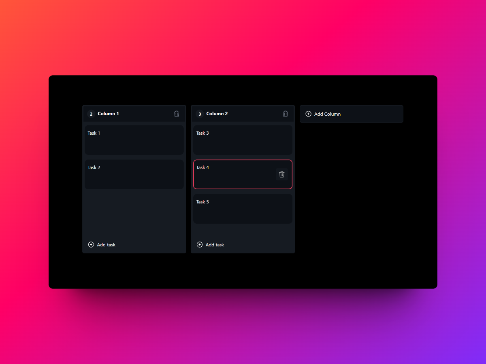

# DevBoardAi 📝



## 🌐 Live Demo

Deploy this project to Vercel using the instructions below, then replace this
placeholder with the generated deployment URL:

`https://your-devboard-ai.vercel.app`

Welcome to the **DevBoardAi** project! This is a modern, intuitive, and feature-rich developer board built with the following awesome technologies:

- ⚡ **Vite** for blazing fast project setup and development
- ⚛️ **React** with **TypeScript** for a robust and scalable frontend
- 🎨 **Tailwind CSS** for beautiful and customizable UI components
- 🖱️ **dnd-kit** for smooth and responsive drag-and-drop functionality
- 🐻 **Zustand** for simple and efficient state management

## 🚀 Getting Started

Follow these steps to get the project up and running on your local machine.

### Prerequisites

- [Node.js](https://nodejs.org/) (version 14 or later)
- [npm](https://www.npmjs.com/) or [yarn](https://yarnpkg.com/)

### Installation

1. **Clone the repository**

   ```bash
   git clone https://github.com/crist-pereyra/devboard-ai.git
   cd devboard-ai
   ```

2. **Install dependencies**

   ```bash
   npm install
   ```

3. **Configure AI summaries (optional, local only)**

   Create a `.Env` file for local serverless development. The API key is read
   only by the serverless function:

   ```env
   OPENROUTER_API_KEY=your_api_key_here
   OPENROUTER_MODEL=openrouter/free
   APP_URL=http://localhost:5173
   ```

   Never use a `VITE_` prefix for the key. For Vercel, add these values in
   Project Settings > Environment Variables. Do not commit `.Env`.

### Running the Development Server

Start the development server with the following command:

```bash
npm run dev
```

Open your browser and navigate to http://localhost:5173 to see DevBoardAi in action!

## 📂 Project Structure

Here's an overview of the project's structure:

```php
devboard-ai/
├── public/                 # Public assets
├── api/                    # Serverless AI endpoint
├── src/                    # Source code
│   ├── assets/             # Static assets
│   ├── components/         # React components
│   ├── hooks/              # Custom hooks
│   ├── icons/              # Icons
│   ├── stores/             # Zustand store
│   ├── App.css             # Styles
│   ├── App.tsx             # Main App component
│   ├── index.tsx           # Entry point
├── .gitignore              # Git ignore file
├── index.html              # HTML template
├── package.json            # Project metadata and scripts
├── tailwind.config.js      # Tailwind CSS configuration
├── tsconfig.json           # TypeScript configuration
└── vite.config.ts          # Vite configuration

```

## 🛠️ Key Features

- **Drag and Drop**: Effortlessly move tasks between columns using dnd-kit.
- **State Management**: Efficient and minimal state management with Zustand.
- **Type Safety**: Benefit from TypeScript's type-checking to minimize errors
- **Workflow Templates**: Start with software, bug tracking, content, personal, or custom workflows.
- **Task Management**: Set priority and due dates, search tasks, and filter by priority.
- **Safe Editing**: Delete confirmations and undo support protect board changes.
- **AI Summary**: Generate a concise progress summary, blockers, and next priority from the board.

## 🚀 Deployment

The app is configured for Vercel:

```bash
npm run build
```

Set `OPENROUTER_API_KEY`, `OPENROUTER_MODEL`, and `APP_URL` in the deployment
environment. The frontend calls `/api/summarize`; the OpenRouter key never
ships to the browser.

### Responsive review checklist

- Desktop: verify the board toolbar, columns, drag-and-drop, and summary panel.
- Mobile: verify horizontal board scrolling, wrapped toolbar controls, card
  editing, priority/date controls, and delete/undo actions.
- Use the preview image above as the visual reference for the main board.

## 📜 License

This project is licensed under the MIT License.
